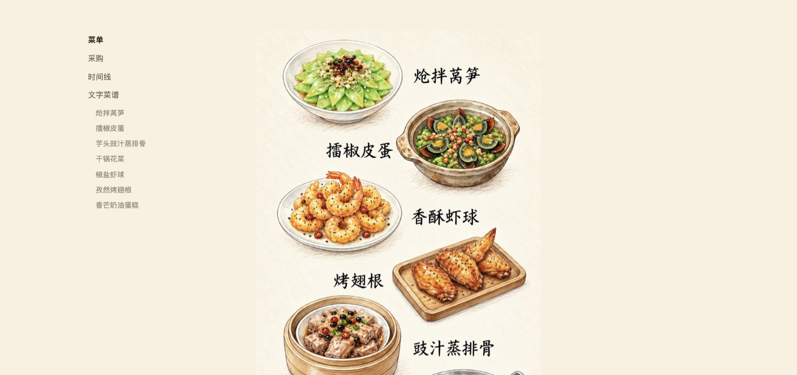
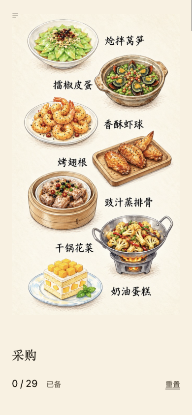
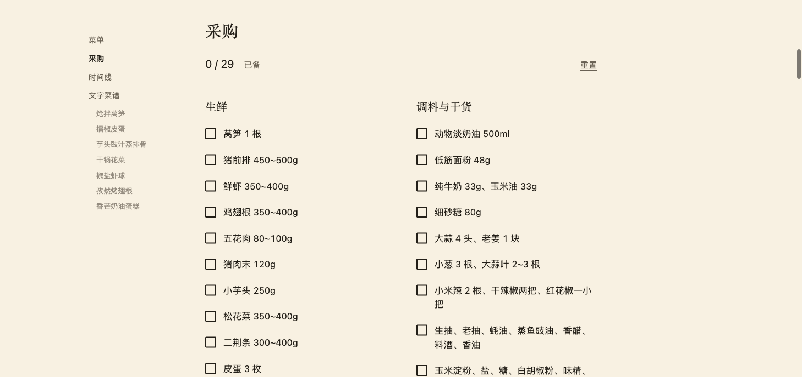
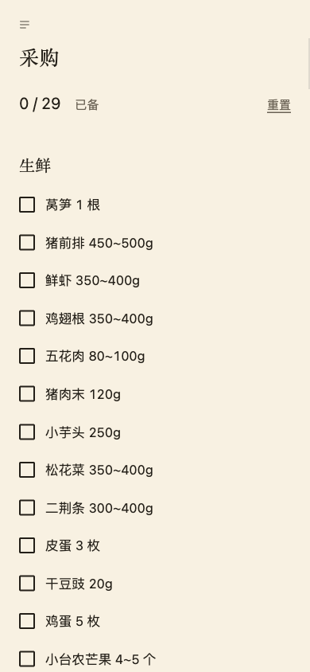
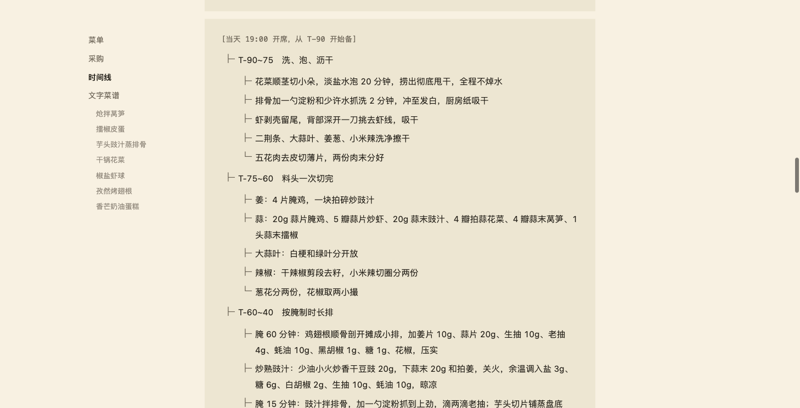
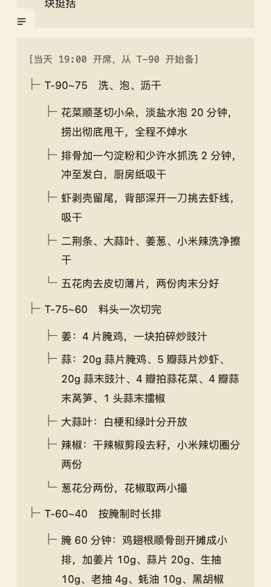
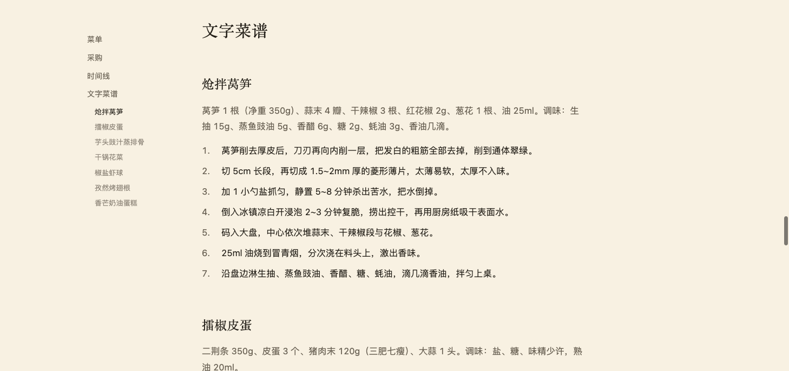
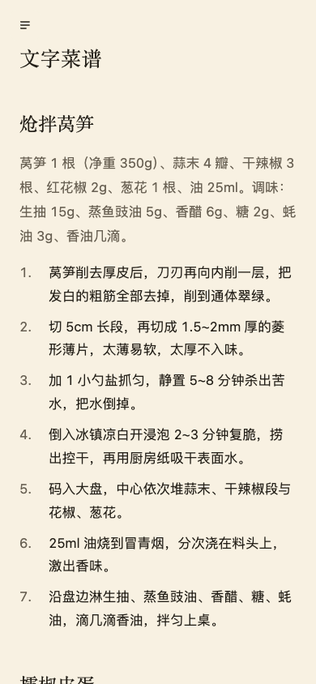

# 美味的主厨 · The Flavor Chef

## 使用示例

复制下面这句话，把最后的占位内容换成你的菜谱链接：

```text
参考 https://github.com/Asherzzzz/flavor-chef 帮我安排一桌菜，菜谱链接：[链接1]、[链接2]、[链接3]。
```

## 效果预览

| 内容 | 桌面端 | 移动端 |
| --- | --- | --- |
| 菜单 |  |  |
| 采购清单 |  |  |
| 时间线 |  |  |
| 文字菜谱 |  |  |
